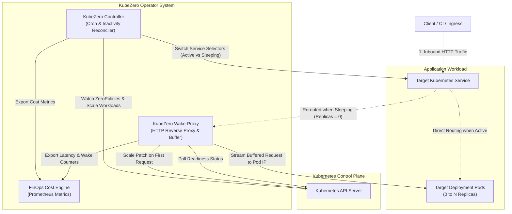
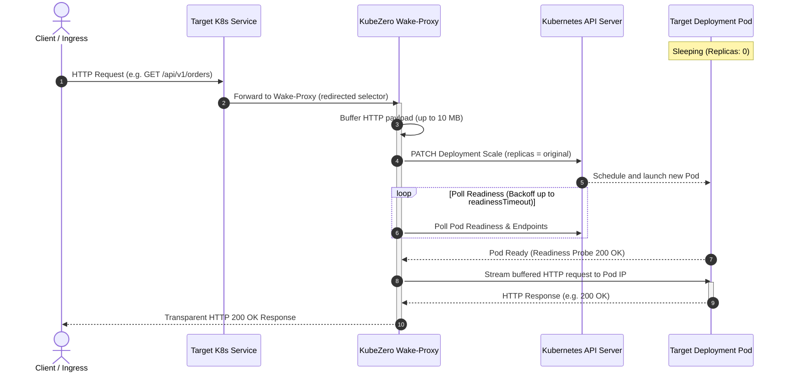
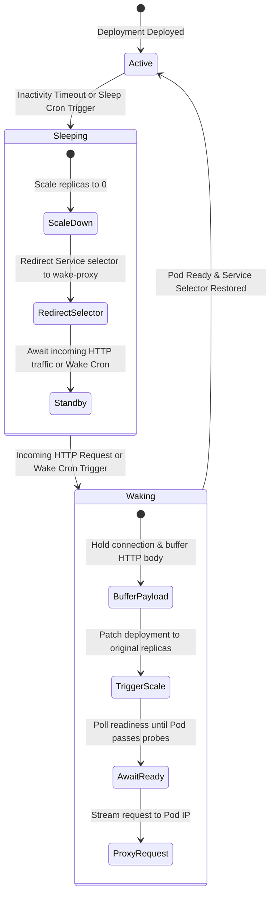
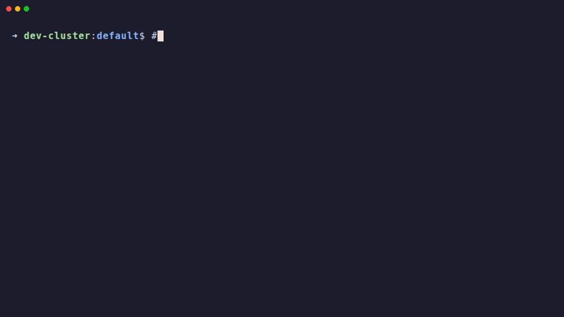
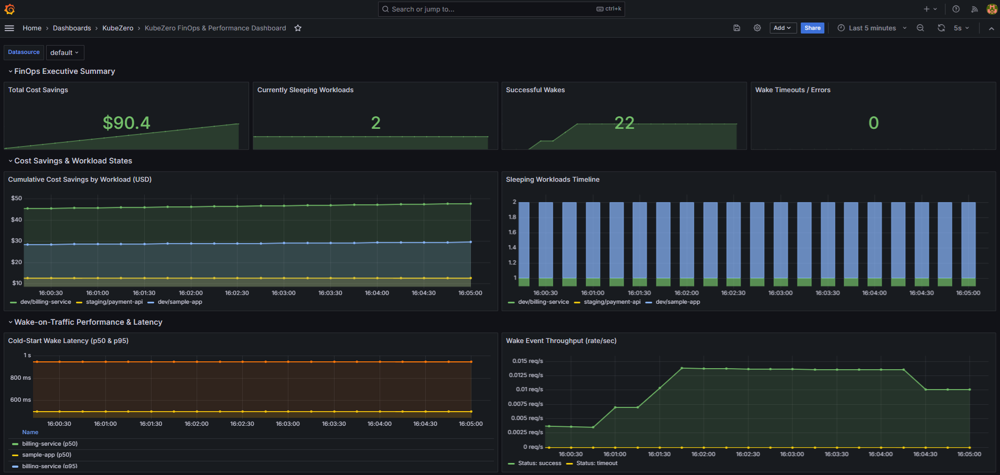

# KubeZero

[](https://github.com/dawidbera/kube-zero/actions/workflows/ci.yaml)

Kubernetes FinOps Auto-Sleep & Wake-on-Traffic Operator written in Go.

---

## Architecture Overview



KubeZero combines three essential capabilities:
1. **Automated Scale-to-Zero:** Based on cron schedules or inactivity timeout, idle workloads are scaled to 0 replicas.
2. **Wake-on-Traffic Interception:** When an HTTP request hits a sleeping service, the KubeZero reverse proxy intercepts the connection, scales the deployment back up via the Kubernetes API, buffers the request during pod startup, and forwards it transparently once health checks pass.
3. **FinOps Cost Reporting:** Measures cumulative sleep hours and exports Prometheus metrics with estimated dollar savings.

---

## Wake-on-Traffic Request Flow

The following sequence diagram details the cold-start wake lifecycle when an HTTP request arrives for a workload scaled to 0 replicas:



---

## Lifecycle State Machine

Workloads managed by KubeZero transition between active, sleeping, and waking states according to traffic demand and scheduling:



---

## See It in Action (Live E2E Demo)



You can spin up an ephemeral Kubernetes cluster (k3d), build and install KubeZero via Helm, and observe automated scale-to-zero followed by instant wake-on-traffic cold-start forwarding with a single command:

```bash
make test-e2e
```

The automated test harness in [hack/test-e2e.sh](file:///home/d/project-name3/kube-zero/hack/test-e2e.sh) validates the entire operator lifecycle:

```text
==================================================
 Starting KubeZero End-to-End (E2E) Test Suite
==================================================
==> Step 1: Provisioning local k3d cluster 'kubezero-e2e'...
==> Step 2: Importing KubeZero images into k3d cluster...
==> Step 3: Installing KubeZero Helm chart...
==> Step 4: Waiting for KubeZero operator pods to be Ready...
==> Step 5: Deploying demo upstream service (sample-app)...
[+] sample-app is deployed with 2 ready replicas.
==> Step 6: Applying ZeroPolicy for sample-app...
==> Step 7: Verifying scale-down and Service selector redirection...
[+] Workload scaled to 0 replicas and Service redirected to kubezero-wake-proxy!
==> Step 8: Triggering Wake-on-Traffic via HTTP request...
Received HTTP response: Hello from KubeZero Target App!
[+] Success! Wake-proxy intercepted request, revived sample-app pod, and transparently proxied HTTP response.
[+] Post-wake deployment replica count: 1
[+] Success! Service selector successfully restored to target application pod!
==================================================
 KubeZero E2E Verification Passed Successfully!
==================================================
```

---

## How It Works (Lifecycle Walkthrough)

1. **Active Workload:**
   Target application runs normally with desired replicas:
   ```bash
   kubectl get deployment sample-app
   # NAME         READY   UP-TO-DATE   AVAILABLE
   # sample-app   2/2     2            2
   ```

2. **Scheduled Sleep:**
   When the sleep cron triggers (or idle timeout expires without traffic), the KubeZero controller scales replicas to 0 and reroutes the Kubernetes Service selector to the Wake Proxy:
   ```bash
   kubectl get deployment sample-app
   # NAME         READY   UP-TO-DATE   AVAILABLE
   # sample-app   0/0     0            0

   kubectl get service sample-app -o jsonpath='{.spec.selector}'
   # {"app.kubernetes.io/name":"kubezero-wake-proxy"}
   ```

3. **Wake-on-Traffic Trigger:**
   When an engineer, CI pipeline, or QA tester sends an HTTP request to the sleeping service:
   ```bash
   curl -i http://sample-app:8080/api/orders
   ```
   - Wake-Proxy intercepts the request and buffers the body payload (up to 10 MB).
   - Wake-Proxy triggers a scale-up patch to restore desired replicas.
   - Once the pod passes readiness probes, Wake-Proxy forwards the request directly to the revived container.
   - The caller receives HTTP `200 OK` seamlessly with minimal cold-start latency.

4. **FinOps Savings Calculation:**
   Savings are calculated in real time based on vCPU and RAM requests multiplied by sleep duration:
   ```bash
   curl http://localhost:9091/metrics | grep kubezero_cost_savings_usd_total
   # kubezero_cost_savings_usd_total{deployment="sample-app",namespace="default"} 4.52
   ```

---

## Installation via Helm

Install KubeZero into your Kubernetes cluster using the provided Helm chart:

```bash
# Add and install from the local chart directory
helm install kube-zero ./charts/kube-zero -n kube-zero --create-namespace
```

Verify that all pods and CRDs are running:

```bash
kubectl get pods -n kube-zero
kubectl get crd zeropolicies.finops.kubezero.io
```

---

## Configuration Example (ZeroPolicy CRD)

Workloads are configured by applying a `ZeroPolicy` custom resource in the target namespace. The manifest below sets up scheduled sleep (off-hours and weekends), a 30-minute inactivity timeout, automatic Wake-on-Traffic interception, and cloud cost rate profiles:

```yaml
apiVersion: finops.kubezero.io/v1alpha1
kind: ZeroPolicy
metadata:
  name: sample-app-policy
  namespace: default
spec:
  # Target workload selector
  targetRef:
    kind: Deployment
    name: sample-app

  # Scheduled sleep windows (Cron syntax): Mon-Fri 19:00 to 07:00 UTC, all weekend
  schedule:
    sleepCron: "0 19 * * 1-5"
    wakeCron: "0 7 * * 1-5"
    timezone: "UTC"

  # Dynamic scale-to-zero when idle without HTTP traffic
  inactivity:
    enabled: true
    idleTimeout: "30m"

  # Intercept HTTP requests when sleeping and wake workload transparently
  wakeOnTraffic:
    enabled: true
    servicePort: 8080
    targetPort: 8080
    readinessTimeout: "45s"
    maxBufferedBodyBytes: 10485760 # 10MB body buffer limit

  # FinOps cost profile (AWS c6i.large baseline: $0.0416/core-hr, $0.0052/GB-hr)
  costProfile:
    hourlyCpuCoreCostUsd: 0.0416
    hourlyMemoryGbCostUsd: 0.0052
```

---

## Observability & Grafana Dashboard



KubeZero exposes native Prometheus metrics on port `9090` (wake-proxy) and `9091` (controller):
- `kubezero_cost_savings_usd_total`: Cumulative financial savings in USD calculated from avoided vCPU and RAM usage.
- `kubezero_sleeping_deployments`: Active count of workloads scaled to 0.
- `kubezero_wake_events_total`: Total count of Wake-on-Traffic activations by status (`success`, `timeout`, `scale_error`).
- `kubezero_wake_duration_seconds`: Histogram observing cold-start latency from HTTP trigger to pod ready state.

A pre-built, production-ready Grafana dashboard is available in [dashboards/grafana-dashboard.json](file:///home/d/project-name3/kube-zero/dashboards/grafana-dashboard.json).

### Accessing Grafana

- **Local Development (Docker Compose):**
  Grafana is served at **`http://localhost:3000`** (Username: `admin`, Password: `admin`). The Prometheus datasource and the KubeZero dashboard are automatically provisioned and ready at `http://localhost:3000/d/kubezero-finops/kubezero-finops-and-performance-dashboard`.
- **In a Kubernetes Cluster (e.g. kube-prometheus-stack):**
  Forward the Grafana service port to your local machine:
  ```bash
  kubectl port-forward -n monitoring svc/prometheus-grafana 3000:80
  # Or: kubectl port-forward -n kube-zero svc/grafana 3000:80
  ```
  Then open **`http://localhost:3000`** in your browser.

### Importing the Dashboard

1. Navigate to **`http://localhost:3000`** -> **Dashboards** -> **New** -> **Import**.
2. Upload [dashboards/grafana-dashboard.json](file:///home/d/project-name3/kube-zero/dashboards/grafana-dashboard.json).
3. Select your Prometheus datasource and click **Import**.

---

## Development & Testing

Run unit tests with Go race detection, static analysis, binary builds, and Helm chart validation:

```bash
# Run unit tests with Go race detector
make test

# Run full end-to-end integration test on local k3d cluster
make test-e2e

# Run Go static analysis
make vet

# Build production binaries (bin/controller, bin/wake-proxy)
make build

# Validate Helm chart syntax
helm lint charts/kube-zero
```

### Local Development Stack (Docker Compose)

For testing the Wake Proxy, Prometheus metrics, and Grafana dashboard locally without a Kubernetes cluster:

```bash
docker compose -f docker-compose.dev.yaml up
curl http://localhost:8080/
# Hello from behind KubeZero Wake-Proxy!
```

- **Wake-Proxy:** `http://localhost:8080`
- **Prometheus UI:** `http://localhost:9092`
- **Grafana UI:** `http://localhost:3000` (Login: `admin` / `admin`)

---

## Technical Lessons Learned (Gotchas)

- **Go Memory Footprint in Kubernetes:** Standard Go binaries in a `distroless` container run comfortably with a memory footprint under 25 MB, avoiding the node overhead associated with running operators in JVM or Node.js.
- **Connection Buffering & Direct Routing:** During pod cold-starts (typically 5 to 15 seconds), the reverse proxy holds the client socket open and buffers payloads (capped at 10 MB) to prevent denial-of-service through memory exhaustion. Routing directly to the revived Pod IP avoids circular routing loops on temporarily modified Service selectors.
